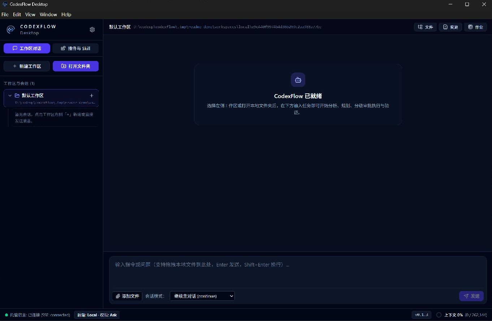
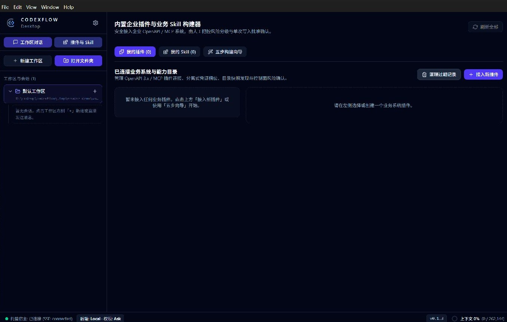
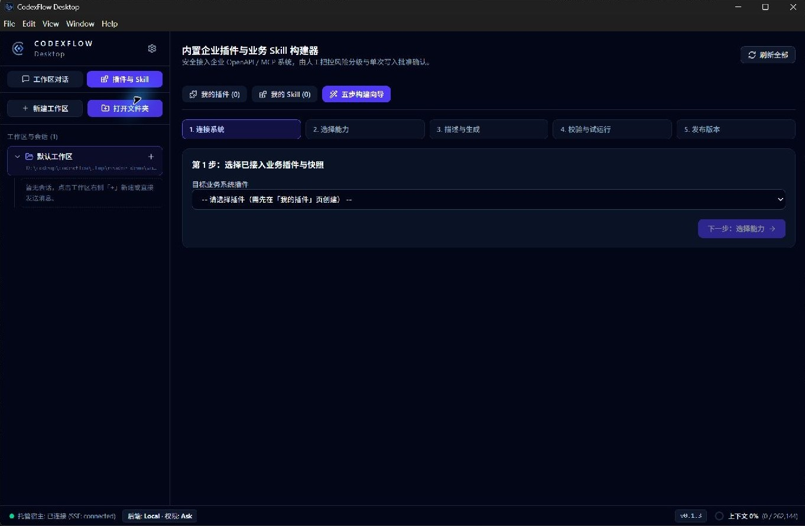
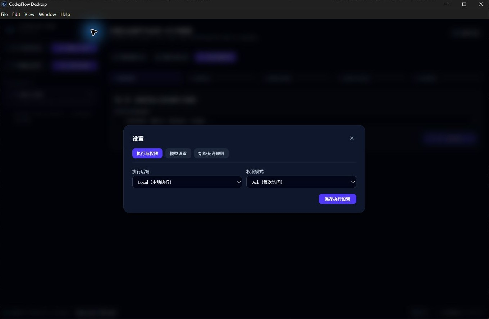
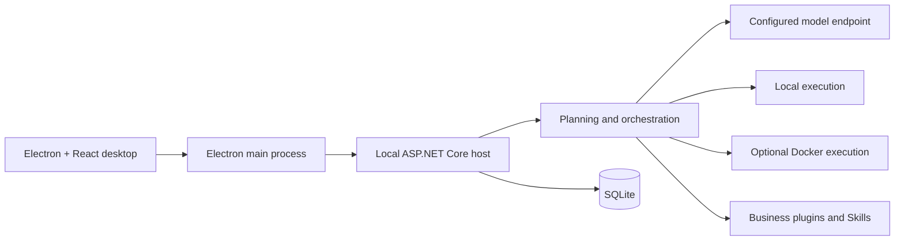

English | [简体中文](README.zh-CN.md)

# CodexFlow

**An AI coding workspace on your desktop, with local execution, human approvals, and reusable business Skills.**

[Official website](https://codexflow.ai)

CodexFlow brings conversations, planning, tool approvals, workspace files, changes, and jobs into one Electron application. A .NET host runs locally, persists state in SQLite, and connects to your configured model endpoint. You can work against a local folder, review a proposed plan, approve execution, and inspect the result without switching between separate API scripts.

The first-generation desktop application is implemented. The source version is **0.1.8**; this repository contains the desktop client, local host, reusable .NET libraries, and test tooling.



## Contents

- [Features](#features)
- [Screenshots](#screenshots)
- [Download & install](#download--install)
- [Run from source](#run-from-source)
- [Your first workflow](#your-first-workflow)
- [Modes & conversation threads](#modes--conversation-threads)
- [Plugins and business Skills](#plugins-and-business-skills)
- [Configuration and data](#configuration-and-data)
- [Standalone host](#standalone-host)
- [Execution and verification](#execution-and-verification)
- [Architecture](#architecture)
- [Development and testing](#development-and-testing)
- [Troubleshooting](#troubleshooting)
- [Documentation and license](#documentation-and-license)

## Features

| Area | What you can do |
| --- | --- |
| Workspace conversations | Create workspaces, open local folders, and organize multiple conversations under each workspace. |
| Chat experience | Read streamed responses, Markdown and code blocks; attach files; inspect tool calls and context usage. |
| Planning and approvals | Review plans and respond to tool execution approval cards before the relevant operation proceeds. |
| Workspace inspection | Open the Files, Changes, and Jobs panels alongside the conversation. |
| Execution | Use local execution or opt into a Docker backend for isolated execution and container verification. |
| Model settings | Configure the endpoint, API mode, model, context limit, and sampling parameters from the desktop UI. |
| Business integrations | Manage OpenAPI / MCP business plugins, discover capabilities, and build reusable Skills through a five-step wizard. |
| Local lifecycle | Let the desktop manage its backend, or connect it to an independently running local host. |
| Persistence and recovery | Keep application state in SQLite; use SSE streaming with reconnection and reconciliation. |

Local execution uses your machine and its installed tools. A locally running host does not imply that model inference is offline: prompts and relevant task context go to the model endpoint you configure.

## Screenshots

These are real Windows screenshots captured with computer use from a source-built desktop client on **2026-11-17**. The client was connected to its real managed backend using a separate, empty demonstration data directory. No sample conversations or successful jobs were fabricated.

### Plugin catalog

Manage business system connections and capability catalogs in one place.



### Five-step Skill builder

Connect a system → choose capabilities → describe and generate → validate and test → publish a version.



### Execution settings

The captured instance uses **Local** execution and **Ask** permissions.



The screenshot session verified startup, backend connection, and navigation through these screens. It did not run a model task, publish a Skill, or perform Docker verification.

## Download & install

All desktop release packages (Windows x64, macOS arm64, Linux x64) ship with a **self-contained .NET 10 runtime and bundled LibreOffice**. End users do **not** need to manually install `.NET 10`, `Node.js`, or `LibreOffice` to launch the app and run the managed backend. Download releases from [GitHub Releases](https://github.com/iwaitu/codexflow/releases).

### macOS (Apple Silicon / arm64)

> **Note on macOS Gatekeeper**: Open-source releases are currently ad-hoc signed (without a paid Apple Developer notarization certificate). When a `.dmg` is downloaded through a browser, macOS attaches a `com.apple.quarantine` attribute and displays `"CodexFlow Desktop" is damaged and can't be opened`. Use the one-line installer below (recommended) or clear the quarantine attribute after dragging the app into `Applications`.

**Option 1 (Recommended): One-line installer** (downloads the latest `.dmg`, verifies `SHA256SUMS.txt`, installs to `/Applications`, and clears quarantine automatically):

```bash
curl -fsSL https://raw.githubusercontent.com/iwaitu/codexflow/main/scripts/install-macos.sh | bash
```

To pin a specific release tag and launch immediately after install:

```bash
curl -fsSL https://raw.githubusercontent.com/iwaitu/codexflow/main/scripts/install-macos.sh | bash -s -- --version v0.1.15 --open
```

**Option 2: Manual `.dmg` download**:

1. Download `CodexFlow-Desktop-*-mac-arm64.dmg` from [GitHub Releases](https://github.com/iwaitu/codexflow/releases).
2. Open the `.dmg` and drag `CodexFlow Desktop.app` into `Applications`.
3. Remove the browser quarantine attribute once in Terminal, then open the app normally:

```bash
xattr -dr com.apple.quarantine "/Applications/CodexFlow Desktop.app"
```

### Windows (x64)

- Download `CodexFlow-Desktop-*-win-x64-setup.exe` (installer) or `CodexFlow-Desktop-*-win-x64-portable.zip` (portable) from [GitHub Releases](https://github.com/iwaitu/codexflow/releases).
- If Windows SmartScreen warns on an unsigned installer, click **More info → Run anyway**.

### Linux (x64)

- Download the `.AppImage` or `.tar.gz` archive from [GitHub Releases](https://github.com/iwaitu/codexflow/releases):

```bash
chmod +x CodexFlow-Desktop-*-linux-x64.AppImage
./CodexFlow-Desktop-*-linux-x64.AppImage
```

### Optional toolchain setup (in-app environment diagnostics)

Inside CodexFlow Desktop, click **Environment** in the bottom status bar (or open **Settings → Environment** / the **Environment** tab in the Welcome Wizard) to inspect the local backend, `Git`, `.NET 10 SDK`, `Node.js`, `Python 3`, `Docker`, and `LibreOffice`, and trigger allowlisted one-click installation with live logs whenever your coding workspace needs those toolchains.

## Run from source

### Prerequisites

| Dependency | Purpose |
| --- | --- |
| .NET 10 SDK | Build and run the backend. `global.json` requests `10.0.401` with latest-patch roll-forward. |
| Node.js 22 and npm | Install and run the desktop client; Node 22 is also used by client CI. |
| Git | Clone the repository and support repository workflows. |
| Compatible model endpoint | Required for AI conversations and generation. Model settings accept `ChatCompletions` and `Responses`. |
| Docker (optional) | Needed for Docker execution and container verification. |

Build the backend **before** launching the desktop client. This avoids file locks and ensures the managed host uses the current source.

```powershell
git clone https://github.com/iwaitu/codexflow.git
cd codexflow

dotnet build CodexFlow.Local -c Release

cd clients/desktop
npm ci
npm run dev
```

For a built frontend instead of the development server:

```powershell
# From clients/desktop, after the backend build and npm ci
npm run build
npm run preview
```

The desktop starts and monitors its own local backend. You do not need to start a second `dotnet run` process for this mode. Outside packaged builds, backend discovery prefers the Release executable, then Debug, then falls back to `dotnet run`.

To use an isolated data directory for a demo or development session, set this before starting the desktop:

```powershell
$env:CODEXFLOW_DATA_DIR = Join-Path $env:TEMP 'codexflow-demo'
npm run dev
```

This separates host data; it does **not** isolate user-level model settings. Close the demo instance and remove the environment override from your terminal when returning to your usual data directory.

The repository also defines Windows x64, Linux x64, and macOS arm64 packaging. See the repository's [Releases page](https://github.com/iwaitu/codexflow/releases) for published assets and [release documentation](docs/releasing.md) for the build pipeline. This README's runtime walkthrough was verified on Windows.

## Your first workflow

1. Start the desktop and confirm the bottom status bar reports a connected managed host.
2. Complete the welcome configuration if prompted, or open the gear icon → model settings. Enter the endpoint, API mode, model, and credentials required by your provider.
3. Choose **Open folder** to work with an existing local project, or create a workspace. Use the **+** next to a workspace to add a conversation.
4. Begin with a focused request, for example: “Explain this project's structure and identify its test entry points.”
5. For changes, ask for a plan, review the proposed work, and respond to the relevant approval cards.
6. Inspect **Files**, **Changes**, and **Jobs**. Review verification results and any skipped checks before accepting the outcome.

Example requests:

```text
Explain this repository's entry point and main modules.
Investigate this failing test, propose a fix, then wait for approval.
Implement this small feature and show the changes and test results.
```

These are suggested prompts, not recorded results from the screenshot session. Available actions depend on the configured model, tools, backend, and permissions.

## Modes & conversation threads

CodexFlow separates **workspace work modes**, **Plan Mode**, **conversation thread modes**, and **execution/permission settings** so they can work independently without interfering with one another.

### 1. Workspace work modes (`Development` vs. `Daily`)

A session's work mode is locked when the workspace session is created (in-place `PATCH` mode changes are rejected with `400 mode_immutable`). Clicking the **开发模式 / 日常模式** badge in the top bar or composer lets you open **日常助手** or create a new session in the target mode:

| Work mode | How to enter | Intended use & tool behavior |
| --- | --- | --- |
| **Development** (`开发模式`) | **Open folder** on a local project, `/dev`, or `POST /api/gateway/session` (default `workMode=development`) | Software engineering, codebase analysis, multi-agent planning, file editing, **Changes** diff review, and **Jobs** verification. `run_shell` is not exposed here. |
| **Daily** (`日常模式` / **日常助手**) | **日常助手** shortcut in the sidebar (opens a dedicated protected workspace), **New workspace** (folderless desktop default), or `/daily` | Office workflows, document organization, read-only authorized folder inspection (`list_authorized_directory`), and **per-invocation approved** local shell scripts (`run_shell`). Workspace **Changes** and **Jobs** panels are hidden, and external repository folders cannot be bound to a `Daily` session (`409 daily_external_workspace_forbidden`). |

> Even if `FullAuto` is enabled in execution settings, `run_shell` in `Daily` mode never inherits `FullAuto`: every execution requires an `allow_once` approval verified by control-plane SHA-256 script inspection in the desktop UI.

### 2. Read-only Plan Mode (`/plan`)

**Plan Mode** is an orthogonal read-only overlay that can be toggled inside **either** `Development` or `Daily` without changing the underlying workspace mode:

- **Enter Plan Mode**: Type `/plan` in the composer (or choose **开启只读 Plan Mode** from the mode menu). Tools are restricted to a read-only allowlist—`run_shell`, file writes, and code modifications are disabled. Type `//plan ...` to send a literal `/plan` message without toggling the mode.
- **Exit Plan Mode**: When the assistant finishes planning and calls `exit_plan_mode`, it only sends an exit request (`plan_mode_exit_requested`) and keeps Plan Mode locked. Read-only restrictions are lifted only after you click **确认退出 Plan Mode** on the approval card or run `/plan off` via the control plane (guarded by optimistic version CAS).

### 3. Active conversation selection & API `conversationMode`

In the desktop UI, replies always target **the conversation thread you currently have selected** in the sidebar—no manual thread-routing dropdown is needed:

- **Selected thread**: Selecting any thread in the sidebar sends messages directly to that `conversationId` (`continue-current`).
- **Workspace with no active thread**: Sending a message automatically reuses the workspace's primary `"主会话"` (`Master`) thread or creates one if none exists (`reuse-master`).
- **Starting a new thread**: Click the **`+`** button next to a workspace in the sidebar (or use the command palette) to open and select a fresh conversation thread.

For direct HTTP API callers (`POST /api/gateway/chat`), `conversationMode` supports three routing strategies:

| API `conversationMode` | Display meaning | Backend routing behavior |
| --- | --- | --- |
| `reuse-master` (API default) | 继续主对话 (`continue`) | Uses the provided `conversationId` if valid; otherwise reuses the workspace's latest live `Master` thread (falling back to the latest `Chat` thread, or creating a new `Master` `"主会话"`). |
| `continue-current` | 继续当前线程 | Appends strictly to the provided active `conversationId` (falling back to default resolution only if no valid ID is supplied). |
| `new-thread` | 新建对话线程 (`new thread`) | Forces creation of a brand-new isolated `Chat` thread under the workspace session. |

### 4. Execution & permission modes (Host settings)

Configured separately under Settings → Execution:

- **Execution backend**: `Local` runs supported operations directly on the host machine; `Docker` runs supported operations and verification inside the configured container image.
- **Permission mode**: `Ask` prompts before sensitive or write operations; `FullAuto` auto-approves eligible development actions (excluding `Daily` `run_shell`, which always enforces `allow_once`).

## Plugins and business Skills

The bundled host enables this feature by default (`BusinessSkills:Enabled=true`). Set it to `false` in host configuration to disable it.

The **Plugins & Skill** area provides three views: **My plugins**, **My Skills**, and the **five-step builder**.

1. **Connect a system:** add a business plugin and configure its OpenAPI / MCP connection and credentials.
2. **Choose capabilities:** discover the capability catalog and select the operations needed by the workflow.
3. **Describe and generate:** explain the business task and generate a draft Skill.
4. **Validate and test:** inspect validation feedback and test against the intended system; handle required approvals.
5. **Publish a version:** publish the reviewed Skill and access it from My Skills.

The implementation separates document and execution credential slots and exposes human-controlled risk classification and write-operation approvals. Connections, credentials, model access, and a usable capability catalog are prerequisites for a real workflow; an empty catalog, as shown above, is a fresh starting state.

Business plugin credential persistence currently uses Windows DPAPI. Linux and macOS reject credential persistence until a native secure store is implemented; enabling the feature does not remove that platform limitation.

## Configuration and data

Model settings saved through the UI are stored in the user-level `~/.codexflow/appsettings.json` and are watched for changes. The settings API returns key status and a masked suffix, rather than the full key. Keep that file and runtime credentials out of source control and screenshots.

Environment variables are useful for scripted standalone launches. Nested .NET settings use double underscores:

| Setting | Purpose |
| --- | --- |
| `VllmAgent__ApiUrl` | Model endpoint URL; the adapter supports an endpoint-name placeholder such as `/v1/{1}`. |
| `VllmAgent__ApiMode` | `ChatCompletions` or `Responses`; match the provider. |
| `VllmAgent__Model` | Provider model identifier. |
| `VllmAgent__ApiKey` | Provider credential for the process environment. |
| `Local__Port` | Standalone listening port; default `32586`. Managed mode requests a dynamic port. |
| `Local__PreflightMode` | Startup checks: use `Report` to report problems without strict startup rejection, or `Off` to disable preflight. |
| `CODEXFLOW_DATA_DIR` | Desktop-managed backend data-directory override. |
| `CODEXFLOW_BACKEND_BIN` | Desktop backend executable or DLL override. |

In managed mode, host data defaults to the desktop application's user-data directory under `host-data`, and backend logs are under `logs/backend.log`. The desktop supplies access and control credentials through a pipe. Standalone mode writes discovery/token files for client connections. Back up the data directory with the host stopped; user-level settings are separate from that backup.

## Standalone host

Use this mode for HTTP clients, integrations, or the developer simulation runner. From the repository root, in PowerShell:

```powershell
$env:VllmAgent__ApiUrl = 'https://your-model-host/v1/{1}'
$env:VllmAgent__ApiMode = 'ChatCompletions'
$env:VllmAgent__Model = 'your-model'
# Supply VllmAgent__ApiKey securely in the process environment.
dotnet run --project CodexFlow.Local
```

The host listens on loopback, normally `http://127.0.0.1:32586`. Use the generated `host.token` for API authentication; missing or invalid credentials return `401`. The desktop connection wizard can discover a local instance or accept its address and token file. Operations requiring the control plane also need the corresponding control credential.

See [OpenAPI contracts](docs/contracts/openapi.json) and [SSE event schemas](docs/contracts/sse-events.schema.json) for the API surface. There is no dedicated `codexflow` CLI in this repository; the desktop application and HTTP host are the primary entry points.

## Execution and verification

**Local** runs supported commands on the host machine. **Docker** runs work in the configured container environment. Permissions and isolation are separate choices: approval is not a container boundary, and selecting Docker does not eliminate the need to review operations.

For the Docker verification backend, build the pinned image from the repository root:

```powershell
docker build -t codexflow-verification:10.0.403-gitleaks8.30.1 docker/verification
```

Then select/configure the Docker backend. Container verification includes build/test and audit paths; local-mode receipts may explicitly skip container checks. A completed job is not proof that every verification layer passed.

The image and secret-scanning configuration hash are pinned in `CodexFlow.Local/appsettings.json`. If changing `docker/verification/gitleaks.toml`, update the corresponding hash as well.

NuGet advisories are refreshed by the host. npm and PyPI advisory data require offline preparation:

```powershell
python scripts/e2e/prepare-osv-advisories.py --out ./osv-advisories
```

Set `ArtifactAudit:OsvAdvisoryDirectory` to the output directory. The download can be several hundred MB; data older than 48 hours is rejected by the dependency audit path. See the [verification cache guide](scripts/e2e/prepare-restore-cache.md) for related preparation.

## Architecture



| Directory | Responsibility |
| --- | --- |
| `clients/desktop` | Electron lifecycle, preload bridge, React UI, client tests and packaging. |
| `CodexFlow.Local` | Local host entry point and composition. |
| `CodexFlow.Contracts` | Shared contracts. |
| `CodexFlow.Core` | Core services, planning, execution, configuration and business Skill foundations. |
| `CodexFlow.Orchestration` | Gateway sessions, jobs, workflow orchestration and audits. |
| `CodexFlow.Gateway.Http` | HTTP-facing API layer. |
| `CodexFlow.Storage.Sqlite` | SQLite persistence. |
| `CodexFlow.Core.Tests` | Backend unit and integration test coverage. |
| `scripts/e2e/devsim` | Natural-language workflow scenarios and structured assertions. |
| `docs/contracts` | OpenAPI and SSE contracts used by the desktop client. |
| `docker/verification` | Verification image and scanning configuration. |

The library projects are packaged together with a shared version from `Directory.Build.props`. The desktop package version is stamped by the release pipeline.

## Development and testing

Backend tests, from the repository root:

```powershell
dotnet test CodexFlow.Core.Tests
```

Desktop checks, from `clients/desktop`:

```powershell
npm run lint
npm run typecheck
npm test
npm run build
npm run test:e2e
```

Regenerate API types after contract changes with `npm run generate:types`, then review changes under `src/shared/contracts`. Tests requiring Docker or a live model have additional prerequisites; passing client tests alone does not validate those integrations.

For a running standalone host, the developer simulator drives conversations, planning, approvals, jobs, and verification:

```powershell
python scripts/e2e/devsim list
python scripts/e2e/devsim run bugfix-python-pager --api http://127.0.0.1:32586 --token-file .codexflow/host.token
```

Adjust the token path to the active host's actual data directory. See the [devsim guide](scripts/e2e/devsim/README.md) for scenarios and fault injection.

## Troubleshooting

| Symptom | What to check |
| --- | --- |
| Desktop is disconnected or repeatedly restarting | Inspect `logs/backend.log`; confirm the backend executable exists and builds successfully. |
| Backend build cannot copy DLLs | Close the desktop/host using that output directory, build again, then relaunch. |
| Changes to backend source do not appear | Rebuild Release; desktop discovery prefers an existing Release build over Debug. |
| UI opens but AI requests fail | Check endpoint, API mode, model, credentials, and provider connectivity. UI connection status only describes the local backend. |
| API returns `401` | Use the token from the active host instance and correct data directory. |
| Approval or settings controls are unavailable | Check whether the standalone connection has control-plane credentials. |
| Skill builder cannot proceed | Connect a plugin, discover capabilities, and confirm model configuration and feature availability. |
| Docker verification fails | Check the Docker daemon, pinned image, verification caches, and advisory freshness. |

## Documentation and license

- [Release process](docs/releasing.md)
- [Local execution threat model](docs/local-execution-threat-model.md)
- [Desktop and local execution design](docs/plans/local-execution-and-desktop-client.md)
- [Business Skill builder design](docs/plans/embedded-business-skill-builder.md)
- [Developer simulation guide](scripts/e2e/devsim/README.md)

Design documents describe design intent and may include work beyond a particular release. Use source, release notes, and runtime behavior to establish what is available.

[MPL-2.0](LICENSE). Copyright © 2026 iwaitu.
