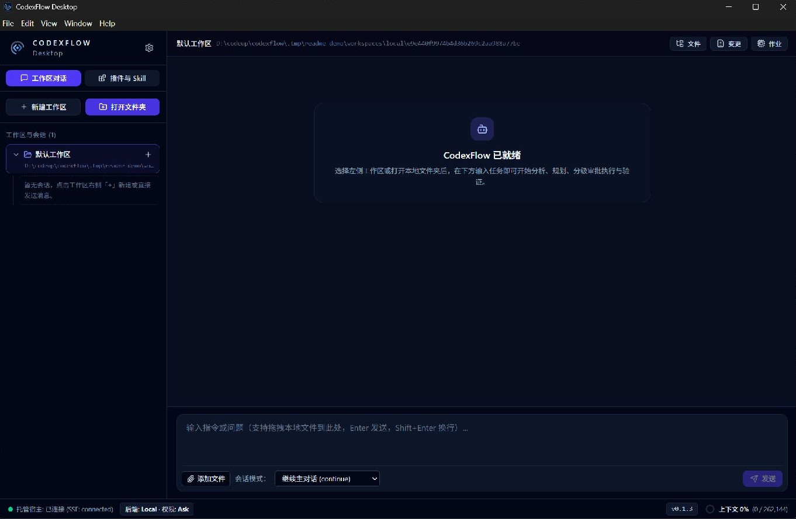
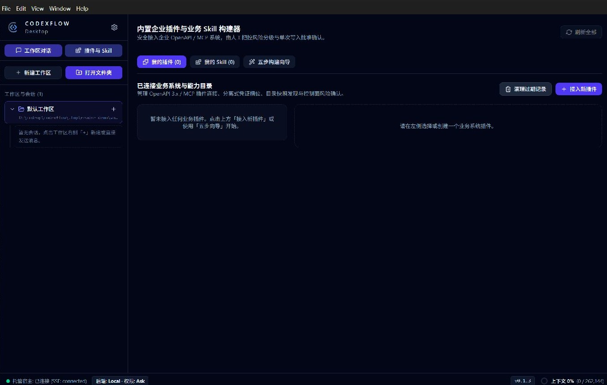
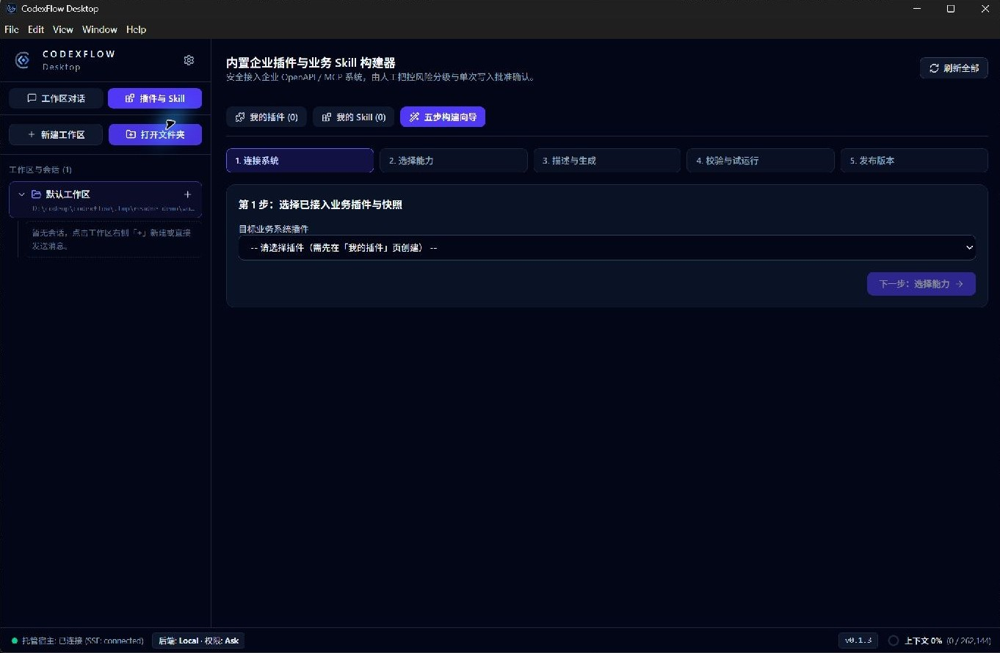
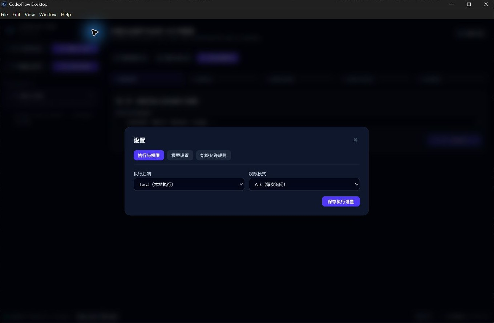
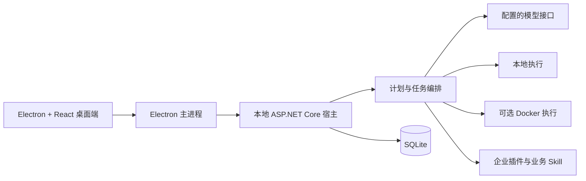

[English](README.md) | 简体中文

# CodexFlow

**在桌面上完成 AI 编码、计划审批、本地执行与业务 Skill 构建。**

CodexFlow 将工作区对话、计划、工具审批、文件、变更和作业放进同一个 Electron 桌面应用。本机运行的 .NET 宿主负责执行与调度，SQLite 保存应用状态，模型能力来自你配置的接口。你可以打开一个本地项目，用自然语言提出任务，审核计划和执行请求，再查看代码变更与验证结果。

初代桌面版本已实现，当前源码版本为 **0.1.8**。本仓库包含桌面客户端、本地宿主、可复用的 .NET 库以及开发测试工具。



## 目录

- [主要功能](#主要功能)
- [界面预览](#界面预览)
- [从源码运行](#从源码运行)
- [第一次使用](#第一次使用)
- [模式与对话线程说明](#模式与对话线程说明)
- [企业插件与业务 Skill](#企业插件与业务-skill)
- [配置与数据存储](#配置与数据存储)
- [独立运行 HTTP 宿主](#独立运行-http-宿主)
- [执行模式与结果验收](#执行模式与结果验收)
- [项目架构](#项目架构)
- [开发与测试](#开发与测试)
- [常见问题](#常见问题)
- [相关文档与许可](#相关文档与许可)

## 主要功能

| 功能 | 可以做什么 |
| --- | --- |
| 工作区与会话 | 新建工作区、打开本地文件夹，在每个工作区下组织多个对话。 |
| 对话体验 | 流式显示回复，渲染 Markdown 和代码，添加文件，查看工具调用与上下文用量。 |
| 计划与执行审批 | 阅读计划，通过审批卡片确认计划或相关工具执行请求。 |
| 文件、变更与作业 | 在对话旁打开对应面板，检查工作区内容、代码改动和任务状态。 |
| 本地与 Docker 执行 | 使用本机工具执行任务，也可配置 Docker 后端进行隔离执行和容器验收。 |
| 模型设置 | 在界面中配置接口地址、API 模式、模型、上下文上限和采样参数。 |
| 企业插件与 Skill | 管理 OpenAPI / MCP 业务插件，发现能力，通过五步向导生成可复用业务 Skill。 |
| 后端生命周期 | 由桌面端启动和管理本地宿主，也可连接已经独立运行的宿主。 |
| 持久化与连接恢复 | SQLite 保存状态，SSE 提供流式事件、断线重连与状态同步。 |

本地执行使用这台电脑上的工具和环境。本地宿主不等于离线模型：对话与相关任务上下文会发送到你配置的模型接口。

## 界面预览

以下为 **2026-11-17** 从源码构建后，通过 computer use 在 Windows 上操作并截取的真实界面。客户端连接真实托管后端，使用独立的空白演示数据目录；未伪造对话、插件或成功作业。

### 企业插件中心

集中管理业务系统连接、能力目录以及插件配置。



### 五步 Skill 构建向导

连接系统 → 选择能力 → 描述与生成 → 校验与试运行 → 发布版本。



### 执行与权限设置

截图中的实例使用 **Local（本地执行）** 和 **Ask（每次询问）**。



本次截图验证了应用启动、后端连接和上述页面访问；未执行模型任务、真实业务 Skill 发布或 Docker 验收。

## 从源码运行

### 环境要求

| 依赖 | 用途 |
| --- | --- |
| .NET 10 SDK | 构建和运行后端。`global.json` 指定 `10.0.401`，允许使用同系列较新补丁版本。 |
| Node.js 22 与 npm | 安装和运行桌面端；客户端 CI 同样使用 Node 22。 |
| Git | 拉取源码及进行仓库相关操作。 |
| 兼容的模型接口 | AI 对话和生成需要；模型设置接受 `ChatCompletions` 与 `Responses`。 |
| Docker（可选） | Docker 执行与容器验收需要。 |

先构建后端，再启动桌面端，避免正在运行的宿主锁定 DLL，也确保客户端加载本次源码构建的后端。

```powershell
git clone https://github.com/iwaitu/codexflow.git
cd codexflow

dotnet build CodexFlow.Local -c Release

cd clients/desktop
npm ci
npm run dev
```

如果希望运行构建后的前端，而不是开发服务器：

```powershell
# 在 clients/desktop 中执行，先完成后端构建与 npm ci
npm run build
npm run preview
```

桌面端会自动启动并监控本地后端，托管模式不需要再手动运行第二个 `dotnet run`。非安装包模式下，客户端优先使用 Release 后端，其次使用 Debug；两者均不存在时才回退到 `dotnet run`。

为演示或开发使用独立数据目录，可以在启动前设置：

```powershell
$env:CODEXFLOW_DATA_DIR = Join-Path $env:TEMP 'codexflow-demo'
npm run dev
```

该变量隔离宿主数据，**不会隔离用户级模型设置**。返回常用数据目录时，关闭演示实例并从终端中移除这个环境变量覆盖。

仓库定义了 Windows x64、Linux x64、macOS arm64 的打包配置。已发布产物请查看仓库的 [Releases 页面](https://github.com/iwaitu/codexflow/releases)，构建流程见[发布文档](docs/releasing.md)。本文的实际运行与截图验证范围为 Windows。

## 第一次使用

1. 启动应用，确认底部状态栏显示托管宿主已连接。
2. 首次提示时完成欢迎配置，或点击齿轮 → 模型设置，填写服务商要求的接口地址、API 模式、模型与凭据。
3. 点击“打开文件夹”使用已有本地项目，或新建工作区。点击工作区右侧的“+”建立新会话。
4. 先提出明确的小任务，例如“解释这个项目的目录结构，并指出测试入口”。
5. 需要修改代码时，先查看计划，再根据审批卡片确认相关操作。
6. 打开“文件”“变更”“作业”面板检查结果，关注验证结论和跳过的检查，再决定是否接受。

可以尝试的提问：

```text
解释这个仓库的程序入口和主要模块。
分析这个测试失败的原因，提出修复计划，等待我批准。
实现这个小功能，并展示代码变更和测试结果。
```

这些是使用示例，并非截图会话中已经完成的任务。实际能力取决于模型、已配置工具、执行后端与权限。

## 模式与对话线程说明

CodexFlow 将 **工作模式**、**Plan Mode**、**对话线程模式** 以及 **宿主执行与权限设置** 拆分管理，彼此正交、互不混淆。

### 1. 会话工作模式（开发模式 vs. 日常模式）

工作区会话的工作模式在创建时锁定，创建后不可原地修改（`PATCH` 修改会被拒绝并返回 `400 mode_immutable`）。点击界面顶部或输入框左下角的 **开发模式 / 日常模式** 徽标，可快速切换到 **日常助手** 或新建对应模式的独立会话：

| 工作模式 | 进入方式 | 适用场景与工具能力差异 |
| --- | --- | --- |
| **开发模式** (`Development`) | **打开文件夹**绑定本地项目、输入框执行 `/dev`、或调用 `POST /api/gateway/session`（默认 `workMode=development`） | 面向代码研发：代码分析、多代理规划、文件改动、右侧 **变更** Diff 与 **作业** 验收面板，以及开发计划审批卡片。此模式下不暴露 `run_shell`。 |
| **日常模式** (`Daily` / **日常助手**) | 左侧 **日常助手** 快捷入口（进入受保护的专属 `日常助手` 托管空间）、无文件夹 **新建工作区**（桌面端默认）、或执行 `/daily` | 面向日常办公：文档处理、授权目录浏览（`list_authorized_directory`）以及 **按次人工确认** 的本地 Shell 指令（`run_shell`）。日常模式下隐藏工程用的 **变更** 与 **作业** 面板，且禁止绑定外部本地代码目录（`409 daily_external_workspace_forbidden`）。 |

> 即使在设置中选择了 `FullAuto` 自动权限，日常模式下的 `run_shell` 也**不会继承**自动放行：每次执行都必须经桌面端控制面核验脚本 SHA-256 后由用户点击「允许一次 (`allow_once`)」。

### 2. 只读规划模式（Plan Mode / `/plan`）

**Plan Mode** 是可叠加在 **开发模式** 或 **日常模式** 之上的正交只读开关，开启/退出均不改变会话原本的工作模式：

- **开启方式**：在输入框输入 `/plan`（或点击模式菜单中的 **开启只读 Plan Mode**）。开启后工具面收缩为只读白名单，禁用 `run_shell` 及代码/文件写入类工具。如果需要原样发送以 `/plan` 开头的普通消息而不触发切换，输入 `//plan 内容` 即可转义。
- **退出安全门控**：助手调用 `exit_plan_mode` 仅发出退出申请（`plan_mode_exit_requested`），**不会自动解除只读限制**；必须由用户在确认卡片点击 **确认退出 Plan Mode** 或在输入框执行 `/plan off`（通过控制平面与版本 CAS 校验）后，才会恢复当前模式的工具权限。

### 3. 当前会话路由与 API `conversationMode` 说明

桌面端采用**所选即当前会话**的直观交互，输入框下方不再保留额外的线程路由下拉框：

- **已选中会话**：在左侧会话树中点击哪个会话，当前视图与模型回复就会严格落在该会话中（请求自动以 `continue-current` 绑定当前 `conversationId`）。
- **工作区尚未选中具体会话**：直接发送首条消息时，自动复用工作区的 `Master` 主对话线程，若尚无线程则自动创建名为 `"主会话"` 的主对话（`reuse-master`）。
- **需要新开讨论线程**：点击左侧工作区右侧的 **`+`** 按钮（或通过命令面板）新建线程并自动切换过去即可。

如果直接调用后端 HTTP 接口（`POST /api/gateway/chat`），`conversationMode` 参数仍支持以下三种路由策略：

| API `conversationMode` 值 | 语义 | 后端处理行为 |
| --- | --- | --- |
| `reuse-master`（API 默认） | 继续主对话 (`continue`) | 若传入了有效的 `conversationId` 则继续该会话；否则优先查找并复用当前工作区最新的存活 `Master` 主对话（回退到最新 `Chat` 线程，仍无则新建名为 `"主会话"` 的 `Master` 线程）。 |
| `continue-current` | 继续当前线程 | 严格沿用传入的当前 `conversationId` 继续多轮对话（仅当未提供有效线程 ID 时回退到默认逻辑）。 |
| `new-thread` | 新建对话线程 (`new thread`) | 在当前工作区下强制新建一条上下文独立的 `Chat` 对话线程。 |

### 4. 执行后端与权限设置（设置弹窗维度）

位于右上角设置 → 执行与权限，用于控制宿主的运行环境与审批策略：

- **执行后端**：`Local` 直接在本机执行；`Docker` 在隔离容器镜像中执行与验收。
- **权限模式**：`Ask` 在执行写入或高风险操作前弹窗审批；`FullAuto` 自动放行符合规则的开发类操作（但日常模式下的 `run_shell` 始终强制按次审批）。

## 企业插件与业务 Skill

随应用发布的宿主配置默认开启此功能（`BusinessSkills:Enabled=true`）；可在宿主配置中设为 `false` 关闭。

“插件与 Skill”入口包含“我的插件”“我的 Skill”和“五步构造向导”。

1. **连接系统**：接入业务插件，配置 OpenAPI / MCP 连接和凭据。
2. **选择能力**：发现能力目录，选择这项业务流程实际需要的操作。
3. **描述与生成**：用自然语言说明业务任务，生成 Skill 草稿。
4. **校验与试运行**：查看校验反馈，在目标业务系统上试运行，并处理必要的审批。
5. **发布版本**：发布已检查的 Skill，在“我的 Skill”中使用和查看。

实现中区分文档凭据与执行凭据，提供人工风险分级和写入操作审批。真实流程需要可用的业务系统、凭据、模型和能力目录；截图中的空目录代表尚未接入系统的初始状态。

业务插件凭据持久化当前使用 Windows DPAPI。Linux 和 macOS 在接入原生安全存储前会拒绝保存凭据；开启功能不会解除这一平台限制。

## 配置与数据存储

通过界面保存的模型设置位于用户目录下的 `~/.codexflow/appsettings.json`，配置变化可被后续模型请求读取。设置接口返回密钥是否已配置及掩码尾号，不返回完整密钥。用户配置和运行凭据不应进入 Git 或公开截图。

独立宿主的脚本启动可使用环境变量。.NET 嵌套配置使用双下划线：

| 配置项 | 说明 |
| --- | --- |
| `VllmAgent__ApiUrl` | 模型接口地址，适配器支持 `/v1/{1}` 形式的接口名称占位符。 |
| `VllmAgent__ApiMode` | `ChatCompletions` 或 `Responses`，需与服务商接口匹配。 |
| `VllmAgent__Model` | 服务商提供的模型标识。 |
| `VllmAgent__ApiKey` | 通过进程环境传入的模型凭据。 |
| `Local__Port` | 独立宿主默认端口为 `5206`；桌面托管模式申请动态端口。 |
| `Local__PreflightMode` | 启动预检；`Report` 报告问题但不按严格模式阻止启动，`Off` 关闭预检。 |
| `CODEXFLOW_DATA_DIR` | 覆盖桌面托管后端的数据目录。 |
| `CODEXFLOW_BACKEND_BIN` | 指定桌面端使用的后端可执行文件或 DLL。 |

托管模式默认将宿主数据放在桌面应用用户数据目录的 `host-data` 下，后端日志位于 `logs/backend.log`。访问令牌和控制令牌通过管道交给托管后端。独立模式会写出用于客户端连接的发现文件和令牌文件。

备份时先停止宿主，再备份数据目录；用户级配置需单独备份。

## 独立运行 HTTP 宿主

适合 HTTP 客户端、集成开发和开发者模拟脚本。在仓库根目录使用 PowerShell：

```powershell
$env:VllmAgent__ApiUrl = 'https://your-model-host/v1/{1}'
$env:VllmAgent__ApiMode = 'ChatCompletions'
$env:VllmAgent__Model = 'your-model'
# 通过安全方式在进程环境中提供 VllmAgent__ApiKey。
dotnet run --project CodexFlow.Local
```

宿主监听本机回环地址，通常为 `http://127.0.0.1:5206`。使用生成的 `host.token` 进行 API 身份验证；缺少令牌或令牌错误会返回 `401`。桌面连接向导可以发现本机实例，也可以指定地址与令牌文件；需要控制平面的操作还需对应控制凭据。

接口定义见 [OpenAPI 文档](docs/contracts/openapi.json) 与 [SSE 事件契约](docs/contracts/sse-events.schema.json)。仓库尚未提供独立的 `codexflow` CLI，主要入口为桌面应用和 HTTP 宿主。

## 执行模式与结果验收

**Local** 在宿主机器执行支持的命令，**Docker** 在配置的容器环境中执行。权限审批与执行隔离是两个不同维度：审批不提供容器隔离，选择 Docker 也不代替操作审核。

使用 Docker 验收后端时，先在仓库根目录构建固定版本镜像：

```powershell
docker build -t codexflow-verification:10.0.403-gitleaks8.30.1 docker/verification
```

随后选择或配置 Docker 后端。容器验收包含构建、测试与审计路径；本地模式回执可能明确标记跳过容器检查。作业完成不代表每一层验收均已通过。

镜像名称与密钥扫描配置哈希固定在 `CodexFlow.Local/appsettings.json`。修改 `docker/verification/gitleaks.toml` 时，需要同步更新对应哈希。

NuGet 漏洞公告由宿主刷新；npm 与 PyPI 公告需要离线准备：

```powershell
python scripts/e2e/prepare-osv-advisories.py --out ./osv-advisories
```

将 `ArtifactAudit:OsvAdvisoryDirectory` 指向输出目录。下载可能达到数百 MB；超过 48 小时的公告数据会被依赖审计拒绝。相关缓存准备见[验收缓存指南](scripts/e2e/prepare-restore-cache.zh-CN.md)。

## 项目架构



| 目录 | 职责 |
| --- | --- |
| `clients/desktop` | Electron 生命周期、预加载桥接、React 界面、客户端测试与打包。 |
| `CodexFlow.Local` | 本地宿主入口与服务组装。 |
| `CodexFlow.Contracts` | 共享契约。 |
| `CodexFlow.Core` | 核心服务、计划、执行、配置和业务 Skill 基础能力。 |
| `CodexFlow.Orchestration` | 网关会话、作业、工作流编排与审计。 |
| `CodexFlow.Gateway.Http` | HTTP API 层。 |
| `CodexFlow.Storage.Sqlite` | SQLite 持久化。 |
| `CodexFlow.Core.Tests` | 后端单元测试与集成测试。 |
| `scripts/e2e/devsim` | 自然语言工作流场景与结构化断言。 |
| `docs/contracts` | 桌面端使用的 OpenAPI 与 SSE 契约。 |
| `docker/verification` | 验收镜像与扫描配置。 |

五个库项目共同发布，统一使用 `Directory.Build.props` 中的版本号；桌面包由发布流水线注入对应版本。

## 开发与测试

在仓库根目录运行后端测试：

```powershell
dotnet test CodexFlow.Core.Tests
```

在 `clients/desktop` 运行客户端检查：

```powershell
npm run lint
npm run typecheck
npm test
npm run build
npm run test:e2e
```

接口契约发生变化后，运行 `npm run generate:types`，检查 `src/shared/contracts` 下的变更。依赖 Docker 或真实模型的测试需要相应环境；客户端测试通过不代表这些集成已经验收。

开发者模拟器可对已启动的独立宿主执行自然语言对话、计划审批、作业等待与验收：

```powershell
python scripts/e2e/devsim list
python scripts/e2e/devsim run bugfix-python-pager --api http://127.0.0.1:5206 --token-file .codexflow/host.token
```

令牌路径应按当前宿主的实际数据目录调整。场景说明与故障注入方式见 [devsim 指南](scripts/e2e/devsim/README.md)。

## 常见问题

| 现象 | 检查方向 |
| --- | --- |
| 桌面端未连接或不断重启后端 | 查看 `logs/backend.log`，确认后端文件存在并能成功构建。 |
| 后端构建提示 DLL 无法复制 | 关闭使用该输出目录的桌面端或宿主，重新构建，再启动。 |
| 修改后端源码后看不到变化 | 重新构建 Release；客户端会优先选择已有 Release 产物。 |
| 界面能打开，但模型请求失败 | 检查接口地址、API 模式、模型、凭据和模型服务连通性；界面连接状态仅表示本地后端连接。 |
| API 返回 `401` | 使用当前宿主实例、正确数据目录下的令牌。 |
| 无法审批或修改设置 | 检查独立宿主连接是否提供控制平面凭据。 |
| Skill 向导无法继续 | 先接入插件并发现能力，确认模型配置及该功能是否启用。 |
| Docker 验收失败 | 检查 Docker 服务、固定版本镜像、验收缓存和公告数据新鲜度。 |

## 相关文档与许可

- [发布流程](docs/releasing.md)
- [本地执行威胁模型](docs/local-execution-threat-model.md)
- [桌面端与本地执行设计](docs/plans/local-execution-and-desktop-client.md)
- [业务 Skill 构建器设计](docs/plans/embedded-business-skill-builder.md)
- [开发者模拟指南](scripts/e2e/devsim/README.md)

设计文档可能包含超出某个发行版本的规划，具体可用能力应结合源码、发行说明和实际运行行为确认。

[MPL-2.0](LICENSE)。Copyright © 2026 iwaitu。
