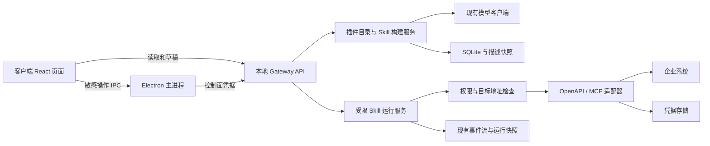

# CodexFlow 内置企业插件与业务 Skill 构建器设计

- 日期：2026-11-17
- 文档版本：v1.1 候选稿
- 状态：已纳入首轮评审建议，待补齐 Claude 评审及同版复审；不代表功能已经实现
- 目标产品：CodexFlow 桌面客户端
- 本次范围：产品交互、接入协议、Skill 生成与执行、权限和存储、实施依赖、测试验收
- 核心需求：用户提供 Swagger/OpenAPI URL 或 MCP 服务地址，浏览接口及注释，勾选或全选，通过自然语言生成可运行的业务 Skill。

## 1. 产品定位与设计决策

构建器直接内置在 CodexFlow 客户端，沿用 Electron + React + TypeScript 界面和本地 .NET 宿主。不另外建设 SaaS 网站，不要求企业先开发 CodexFlow 专用插件。

用户看到的是“连接企业系统 → 选择能力 → 描述业务 → 预览与试运行 → 保存使用”。后台把企业接口转换为受控工具，把业务需求转换为可验证的执行说明。

本设计作出以下决策：

1. Swagger/OpenAPI 和远程 MCP 都属于首版完整交付范围，可分阶段开发，但仅完成 Swagger 不能宣称本需求完成。
2. “填 URL 开始”是默认体验；认证、服务地址选择、特殊参数和业务口径在必要时补齐，不承诺任意系统只填 URL 就能直接调用。
3. 插件是连接和能力的集合；Skill 是使用这些能力完成一个业务目标的可版本化定义。一个插件可以支持多个 Skill。
4. 首版一个 Skill 绑定一个插件、一个环境、一个连接身份；跨系统编排留到后续。
5. 首版生成受限、声明式的业务步骤，不生成并直接运行任意 JavaScript、Python、Shell 或远程网页。
6. 界面展示和业务说明使用 Web 技术；外部 HTTP/MCP 请求、凭据解析和授权判断由本地宿主执行。
7. 复用现有模型接入、审批、事件推送和 SQLite 基础。新增内容限于业务连接、能力目录、Skill 定义和受控运行，不同时重构现有编码 Agent。

### 1.1 已确认事实与待验证事项

本次检查的仓库为 `D:\codeup\codexflow`，基线提交 `e8f9d24`。工作区存在客户端未提交改动，设计读取其当前状态，但不修改这些代码。

| 类别 | 检查结果或设计假设 | 对方案的影响 |
|---|---|---|
| 已检查 | `clients/desktop/package.json` 标注客户端 0.1.3，使用 Electron、React、TypeScript | 在现有客户端增加入口和页面 |
| 已检查 | `clients/desktop/src/shared/ipc.ts` 有 DesktopBridge、审批和设置相关方法 | 扩展类型化 IPC，不暴露任意网络代理 |
| 已检查 | `clients/desktop/electron/main/index.ts` 校验 IPC 来源并代理控制面操作 | 敏感管理动作继续走主进程控制面 |
| 已检查 | `ExecutionApprovalBroker`、审批请求摘要及权限存储已存在 | 可复用审批基础，但企业工具需新增请求类型和规则 |
| 已检查 | `DefaultToolRegistry` 有工具注册、延迟激活、按会话过滤 | 不能把单次 Skill 的授权直接写成全局激活状态 |
| 已检查 | 现有 `SkillTool` 包含文件型 Skill 和脚本执行路径 | 新业务 Skill 不直接套用脚本执行路径 |
| 已检查 | `McpResourceTools.cs` 处理本地资源目录 | 不能据此声称已有远程 MCP 客户端能力 |
| 待验证 | 现有模型客户端对本设计输出 Schema 的适配效果、所选解析库和 MCP SDK 的实际能力 | P0 通过最小样例确认，不在设计中虚构包版本 |
| 用户确认 | 客户端最小 MVP 已完成 | 本文不重新规划客户端 MVP；旧桌面计划中的“缺失能力”不作为当前事实 |

现有参考：[`local-execution-and-desktop-client.md`](local-execution-and-desktop-client.md)。该文档有历史阶段描述，当前实现以代码为准。本设计是新增功能设计，不是整个仓库的完成度审计。

## 2. 用户、场景与完成标准

主要用户是熟悉企业业务、能够取得系统地址和账号权限的业务人员；技术管理员负责提供接口地址、认证方式和特殊接口说明。首版不引入服务器端组织、租户、角色管理，不把本机操作系统账号隔离包装成企业多租户隔离。

### 2.1 主场景：应收账款催收

用户选择“查询客户、查询应收账款、查询回款、创建催收任务”，描述：

> 找出截至指定日期，逾期超过 30 天、未回款金额超过 5 万元的客户，按金额排序，生成催收建议，经过我确认后创建催收任务。

系统需要确认币种、金额口径、账款与回款关联字段、组织范围及“超过”的边界。生成后应明确：输入参数 → 分页查询 → 按确定规则计算 → 生成建议 → 展示待写入清单 → 用户确认 → 创建任务 → 输出逐条结果。

缺少创建接口时，允许用户把目标改为“生成催收建议”；不得悄悄把“创建任务”降级成只输出文字，然后报告成功。

### 2.2 其他首版场景

- 查询指定客户的订单，按订单状态汇总。
- 从 MCP 工具查询工单，筛选超时记录并生成处理建议。
- 查询库存，按用户指定阈值生成补货清单；创建采购单需要单独批准。

完成标准：非开发用户可以在支持范围内，从地址走完两种来源的“发现、选择、描述、试运行、保存、再次调用”；错误结果、数据不完整和写入结果未知均有明确状态。

## 3. 范围和协议兼容矩阵

| 能力 | 首版范围 | 不支持时的行为 |
|---|---|---|
| OpenAPI 描述 | Swagger 2.0、OpenAPI 3.0.x、3.1.x；JSON/YAML | 版本不支持时给出诊断，不假装解析成功 |
| OpenAPI 3.2.x | 后续扩展 | 明确版本不支持，可请求提供兼容描述 |
| Swagger UI 地址 | 尝试读取静态配置中明确的文档地址；不执行远程 JS | 无法确定时让用户填写 JSON/YAML 原始地址 |
| 普通 HTTP 调用 | path/query/header 参数；JSON body；JSON/text/空响应 | multipart、二进制流、回调、Webhook、异步长任务协议首版不可执行，但仍可见并说明原因 |
| 复杂 Schema | 展示原始结构；执行支持经验证的对象、数组、枚举、nullable 等子集 | 无法无损校验或序列化的 oneOf/anyOf 等操作标记不可执行，不让模型猜测 |
| MCP | 远程 Streamable HTTP；首版锁定 2025-11-25 兼容模式 | 仅提供 2026-07-28 模式或其他不支持版本的服务显示兼容性提示 |
| MCP 2026-07-28 | 独立后续适配，不冒用旧初始化和会话逻辑 | 仅当服务明确支持旧版本协商时使用首版模式 |
| 旧 HTTP+SSE / stdio MCP | 后续按真实需求增加 | 首版不自动执行安装命令、不启动本地 MCP 进程 |
| MCP 能力 | tools/list、tools/call、工具列表分页及变化处理 | resources/prompts 不混称可执行 API；sampling、roots、elicitation 不开放，服务请求这些能力时明确失败 |
| 认证 | 无认证、API Key、Bearer、Basic（仅 TLS）；预注册客户端的 OAuth 授权码 + PKCE | SAML、NTLM、Kerberos、任意登录脚本等需企业网关适配；不承诺即插即用 |
| Skill 操作 | 创建、编辑、试运行、发布、停用、复制、回退版本、本地调用 | 插件市场、组织发布、云同步不纳入首版 |

这里的“列出所有 API”指目标文档或当前身份可枚举的全部普通 HTTP operation / MCP tools；不等于能发现服务未公开、当前身份无权发现的接口。不可执行条目也显示，并与可选择条目计数分开。

协议基线是产品兼容性选择，不是对最新标准的断言。MCP 新版本已改变传输与会话行为，不能只更换版本字符串；实施前锁定 SDK、样例服务器和协议测试组合。[MCP 2025-11-25 传输规范](https://modelcontextprotocol.io/specification/2025-11-25/basic/transports)、[MCP 2026-07-28 传输规范](https://modelcontextprotocol.io/specification/2026-07-28/basic/transports/streamable-http)。

## 4. 信息架构与界面

客户端主导航增加“插件与 Skill”。保留当前聊天、工作区和设置入口。

```text
插件与 Skill
├─ 我的插件：连接状态、环境、能力数量、最近刷新、被哪些 Skill 使用
│  └─ 插件详情：接口目录 / 连接与认证 / 更新差异
├─ 我的 Skill：名称、用途、来源、版本、可用状态、最近运行
│  └─ Skill 详情：业务说明 / 步骤 / 输入输出 / 版本 / 运行记录
└─ 新建：连接系统 → 选择能力 → 描述业务 → 预览与试运行 → 保存
```

首版展示简单表单和步骤卡片，不开发拖拽流程图编辑器。业务用户不需要编辑 JSON、HTTP header 或 SKILL.md；高级详情可展开。

### 4.1 连接系统

- 选择“Swagger / OpenAPI”或“MCP 服务”，填写名称和 URL。
- 首次读取前展示访问目标，必要时填写认证。文档读取凭据与业务调用凭据分别配置。
- 探测只读取描述或列举工具，不自动调用业务 API。
- 连接成功显示系统名称、环境、能力数量、解析告警；有多个 server 时让用户选定实际业务环境。
- 认证失败、内网不可达、证书异常、返回登录 HTML、协议不兼容分别提示处理办法。
- 保留已有插件选择入口，避免每建一个 Skill 都重新配置系统。

### 4.2 能力选择

左侧按 tags/分组筛选，中间列表，右侧详情。每行显示：勾选框、业务名称、原始说明摘要、方法/工具名、风险、可执行状态。详情展示完整注释、参数说明、必填项、示例、返回字段和错误响应。

OpenAPI 的 summary/description、参数及 Schema description 都保留；缺少注释显示“源接口未提供说明”。AI 补充解释单独标识，不覆盖原文。远程 Markdown 去除危险 HTML，禁用自动加载远程图片和脚本。

明确提供三个动作：“选择本页”“选择全部筛选结果”“选择全部可用能力”。全选以服务端固定目录版本计算，不受虚拟列表已加载行数限制。显示“共 N 项，可选 M 项，已选 K 项”；跨筛选保留选择；有不可用项时列明排除数量。

勾选表示允许用于构建该 Skill 的候选范围，不表示已经允许任何写入。生成器可以提出“还需要一个接口”的建议，只有用户重新选择后才能加入。

### 4.3 描述业务与必要追问

输入框包含业务目标、输入、筛选条件、结果形式、是否写回系统。支持示例和连续补充。

系统先给出“已理解目标、所需能力、缺少的信息”。对影响结果的组织范围、时间、金额单位、分页、字段关系、写入条件必须追问；普通文案风格等不阻塞生成。返回修改选择时保留描述和已回答问题。

### 4.4 预览、试运行与保存

预览包含业务步骤卡片、输入表单、实际使用能力、写入确认点、数据送往模型的字段、预计调用量、未解决问题。

三个动作严格分开：

- **校验方案**：静态检查，不请求业务 API。
- **只读试运行**：真实查询和生成结果，在第一个未知或写入动作之前停止；不代表写入已验证。
- **执行写入试运行**：用户明确选择环境和确认具体请求后才执行，与正式执行使用同一权限路径。

保存草稿随时可用。发布可用版本需要静态校验通过、必要问题清零、至少一次只读真实试运行成功。包含尚未真实验证写入的 Skill 可以发布，但持续显示“写入步骤未验证”；每次写入都必须按第 8.2 节逐次或按固定批次确认，首次真实执行额外提示尚未验证。此类 Skill 不计入“写入端到端已验收”。

### 4.5 聊天中调用

用户可以从 Skill 卡片点“运行”，也可以在输入框选择 Skill 后补充参数。自然语言自动匹配只推荐，不静默触发写入。

同名 Skill 展示插件、环境和版本供用户区分。业务运行在专用受限执行上下文中，不继承编码聊天里的命令执行、读文件或任意 HTTP 工具。聊天只展示进度、询问和结果卡片。

## 5. 系统结构与现有模块映射



模块名称是拟议职责，不要求为每个方框创建项目或抽象层。

| 位置 | 拟新增或扩展职责 |
|---|---|
| `clients/desktop/src/renderer` | 插件列表、能力选择、业务描述、试运行、版本和运行详情 |
| `clients/desktop/src/shared/ipc.ts` / preload / main | 类型化敏感操作、凭据输入、批准和发布；校验来源与载荷 |
| `CodexFlow.Contracts` | 连接、目录、Skill、运行、错误、事件 DTO |
| `CodexFlow.Gateway.Http` | 本地 API、现有认证/控制面策略、事件查询，不放业务执行逻辑 |
| `CodexFlow.Core` | 规范化目录、Skill 校验、受限步骤执行、工具调用授权；适配器初期就近放置 |
| `CodexFlow.Orchestration` | 模型生成流程与依赖注册，复用现有模型配置 |
| `CodexFlow.Storage.Sqlite` | 实体持久化、不可变版本、运行检查点和迁移 |
| `CodexFlow.Local` | 功能开关、连接默认限制、凭据服务注册、启动诊断 |

主进程不承担企业业务调用代理；渲染进程不保存控制面令牌和长期连接凭据。密码输入会短暂存在输入控件内，但立即送控制面存储并清空，不进入 Zustand 持久化、日志、错误上报或模型消息。

托管模式直接使用现有控制面。连接独立实例时，必须检查实例是否具备可信控制面与凭据服务；缺少时只允许浏览，禁用保存凭据、发布和运行，明确显示原因，不自动开启不安全兼容模式。

## 6. 插件连接与能力目录

### 6.1 统一模型

| 实体 | 主要字段 | 约束 |
|---|---|---|
| Plugin | id、name、sourceType、connectionId、enabled | 一个可复用企业连接的能力集合 |
| Connection | id、sourceUrl、environment、endpointPolicy、documentCredentialRef、executionCredentialRef、revision、credentialRevision | 只存凭据引用；环境/身份变更不能隐式沿用旧确认 |
| CatalogSnapshot | id、pluginId、sourceHash、schemaHash、fetchedAt、protocolVersion、complete、diagnostics | 不可变；complete=false 不可发布引用它的 Skill |
| Capability | id、snapshotId、nativeIdentity、title、description、inputSchema、outputSchema、invocation、risk、executable、diagnostics | 只保存受支持可执行映射，不接受模型构造任意地址 |
| Selection | draftId、catalogSnapshotId、selectedCapabilityIds、revision | 全选冻结成 ID 集，不保存未来动态通配符 |

能力稳定 ID：OpenAPI 使用插件 ID + HTTP method + 规范化 path；MCP 使用插件 ID + 原始 tool name。operationId 用作别名，缺失或重复不能造成能力覆盖。外部显示名允许重复，模型暴露名称采用合法短名称加稳定摘要，防止冲突。

连接 revision 表示非秘密配置变化，credentialRevision 表示凭据轮换或身份变化；目录缓存键同时包含连接、环境、身份范围和协议版本。新身份必须重新枚举目录，不使用另一个身份的工具缓存。

### 6.2 OpenAPI 发现与映射

1. 本地宿主按连接策略读取原始 JSON/YAML；Swagger UI 页面仅解析已知静态配置，无法确定时要求原始文档地址。
2. 检测版本、解析语法、限制大小和递归深度，保留源文档哈希与诊断。
3. 展开普通 paths operation、参数继承和文档说明，解析内部 `$ref`。外部 `$ref` 默认不取；用户授权明确引用目标后可以读取，逐个执行相同目标检查。
4. 把服务器优先级、参数序列化和认证要求编译为适配器调用配置。保留原始规则，以测试证明映射等价。
5. 每个操作分别决定“可执行/需补充配置/不支持”，一项失败不能让其他能力消失。

OpenAPI 的服务器和认证可以在不同层级声明；security 中备选方案与组合要求不能简化成任意取一个 header。具体解析遵循锁定版本规范，并以样例测试验证。[OpenAPI 3.1.1 规范](https://spec.openapis.org/oas/v3.1.1.html)。

产品执行策略：选定 server 后固定 scheme/host/port/path 前缀；模板变量只能取配置中允许的值。请求参数按 schema 与 style/explode 等规则序列化，禁止拼接用户字符串形成新 URL。参数说明可展示全部内容，首版无法支持的序列化必须阻止执行。

分页没有通用业务约定。对每个需要完整集合的步骤，配置明确的游标或页码映射、终止条件和总数校验；AI 可以建议，用户确认，适配器执行。未能证明遍历完整时返回“数据不完整”，不对部分记录宣称全量汇总。

HTTP 200 不自动等于业务成功。若返回 envelope 含业务码，须配置成功/失败判定；若目标要求“任务已创建”，输出契约还需包含创建 ID 或等效证据。204 等无响应接口使用经确认的特定成功契约，不伪造返回数据。

### 6.3 MCP 发现与调用

首版适配器按锁定的 2025-11-25 协议完成初始化与能力协商，通过 `tools/list` 游标获取全部工具，保留名称、描述、输入 Schema、可用输出 Schema 和注解。工具目录协议定义及分页见 [MCP Tools](https://modelcontextprotocol.io/specification/2025-11-25/server/tools)。

- 完成所有分页后才标记 complete=true；循环游标、重复名称、非法 Schema、超限返回明确诊断。
- 工具的只读/破坏性注解是来源提示，不是本地可信授权。未审核能力一律为 unknown；用户确认业务语义后才能标记 read。
- 调用统一映射 `tools/call`；区分传输错误、协议错误、`isError` 和业务失败。
- 结构化输出可以参与确定性数据映射；纯文本可以用于摘要，但不能靠未经确认的正则猜测业务 ID 后自动写入。
- 收到目录变化通知或用户刷新时生成新快照，显示差异；不把新工具自动加入既有选择。
- 服务端要求未声明支持的客户端能力时失败并提示，不开放隐式模型采样、文件系统或递归调用。
- 2026-07-28 支持在独立阶段实现；新规范的请求元数据、结果类型与输入请求机制不能与旧版混用。[MCP 2026-07-28 Tools](https://modelcontextprotocol.io/specification/2026-07-28/server/tools)。

## 7. 自然语言生成 Skill

### 7.1 生成过程

```text
业务描述 + 冻结的选择范围
  → 能力摘要检索
  → 需求澄清和业务字段映射
  → 生成结构化 Skill 候选
  → 静态校验
  → 业务可读预览
  → 试运行与修订
  → 发布不可变版本
```

生成阶段不能调用业务写入。只向模型发送已选择能力中相关项的定义，先摘要再读取详细 Schema，避免把数千接口一次塞入上下文。检索遗漏导致无法完成时必须报告缺失，不能据此断言企业系统没有接口。

结构化输出校验失败最多自动修复两次，之后保留草稿和具体错误；不无限生成。模型输出只是候选数据，不能修改授权、凭据、连接策略、预算或已发布版本。

### 7.2 Skill 规范

以 `skill.json` 为唯一机器执行定义，`SKILL.md` 为由同一版本生成的可读说明。修改文案或结构化定义均通过新草稿，重新生成另一视图并校验，不维护两份可独立执行的真相。

主要字段：

- `schemaVersion`、`skillId`、`version`、`name`、`description`、`pluginId`。
- `connectionBinding`、`catalogSnapshotId`、`selectedCapabilityIds`、`usedCapabilityIds`。
- `inputs`、`outputs`、`steps`、`successCriteria`。
- `dataPolicy`、`budgets`、`validationEvidence`。
- `contentHash`：执行定义的规范化哈希，排除显示时间戳等非行为字段。

首版步骤种类限定为：

| 步骤 | 用途 | 边界 |
|---|---|---|
| tool | 使用选定能力查询或写入 | 只能引用 capabilityId，不能携带任意 URL、header 或脚本 |
| transform | 筛选、排序、分组、求和、字段映射、按键关联/查找 | 采用内置操作和结构化表达式，无 eval；关联有行数上限 |
| branch | 根据已验证值选择有限分支 | 引用存在的步骤、无环 |
| foreach | 对有限结果集合逐项处理 | 必须有上限；写入默认串行 |
| generateText | 生成解释或建议 | 只有明确允许字段可送模型；输出不得直接成为可执行指令 |
| approval | 展示具体待执行写入 | 批准绑定请求摘要，不能通过模型输出满足 |
| output | 汇总结果与证据 | 按 successCriteria 判断，不由模型一句“完成”决定 |

列表分页由 tool 的受限分页配置处理，不新增任意 while 循环。日期计算明确时区和比较边界；金额使用十进制和指定币种，不让语言模型负责精确金额计算。枚举、时间、空值、单位转换必须有显式规则。

按键关联支持两个前置结果集的 inner/left join 和 lookup，明确左右键、键类型、唯一性、缺失匹配及重复键处理；禁止无条件笛卡尔积，输出最多 10,000 行，超限不截断成功。催收场景优先分别批量/分页获取客户、账款和回款，先按账款 ID 汇总回款，再关联账款和客户，避免重复键导致金额倍增或逐客户 N+1 请求。只有企业接口确实无法批量读取时才采用受限逐条查询，并在预览说明调用数量和可处理范围。P0 必须提供此场景的完整数据映射样例。

### 7.3 最小定义示例

以下仅展示格式，不是可以直接导入的完整生产 Skill；正式版本必须补齐上述绑定、策略和证据。

```json
{
  "schemaVersion": 1,
  "skillId": "receivable-summary",
  "version": 1,
  "name": "逾期应收汇总",
  "pluginId": "erp-demo",
  "catalogSnapshotId": "catalog-001",
  "usedCapabilityIds": ["erp-invoices-list"],
  "inputs": {"type": "object", "required": ["asOfDate"], "properties": {"asOfDate": {"type": "string", "format": "date"}}},
  "steps": [
    {"id": "query", "type": "tool", "capabilityId": "erp-invoices-list", "arguments": {"date": {"input": "asOfDate"}}},
    {"id": "result", "type": "output", "source": {"step": "query", "pointer": "/items"}}
  ],
  "successCriteria": {"requiredSteps": ["query", "result"], "requireCompletePagination": true}
}
```

引用采用 `input` 或 `step + JSON pointer` 的结构化形式。不能引用未来步骤；条件分支必须处理缺少输出的情况。参数含业务记录 ID 时保留来源引用，便于预览核对。

### 7.4 静态校验与发布门槛

校验：能力属于冻结选择、used 是 selected 子集、身份和环境匹配、参数类型与必填、Schema 支持程度、数据映射、分支覆盖、无环、循环上限、分页、写入审批、输出证据、隐私策略、预算。

发布操作必须由控制面完成，事务内再次检查草稿 revision、目录哈希、静态校验哈希和试运行证据哈希。任何影响执行的修改都会使旧验证证据失效。发布失败保留草稿，不产生半成品可用版本。

## 8. 执行、审批和恢复

### 8.1 实际授权范围

每次调用按以下交集执行：

```text
已发布 Skill 使用范围
∩ 用户构建时明确选择范围
∩ 当前连接/身份可用范围
∩ 本机策略
∩ 当前运行模式
∩ 本次有效批准
```

“接口隐藏”“模型未看到”不等于权限控制。宿主逐次校验 capabilityId、Skill 版本、运行 ID、绑定环境、参数和策略。禁止从业务运行访问普通聊天的 shell、脚本 Skill、通用 HTTP 等旁路；用户在其他编码聊天中主动运行任意程序不属于本功能可提供的隔离保证。

初始风险默认 unknown。method、名称和 MCP 注解仅供审核建议；未知操作按写入要求批准。只读试运行只允许经用户确认并固定在目录风险配置中的 read 能力。更改风险为 read 是控制面操作，并使相关验证证据失效。

审批复用现有 broker、事件和主进程控制面交互，但新增企业调用请求种类；不得把未知网络调用强行伪装成已有本地命令审批。

### 8.2 写入确认

默认在执行前展示：系统与环境、目标记录、将发生的修改、条数、关键金额、脱敏请求预览。首版只支持本次请求或本次明确批次的批准，不支持“以后所有该接口均自动允许”。

批准摘要绑定 runId、Skill 版本哈希、连接 revision、credentialRevision、能力和目录定义哈希、规范化参数、批次集合、有效期。任意绑定项变化或过期必须重新确认。摘要不得包含明文凭据。

批量审批覆盖固定条目集合，批准后不能添加新记录。用户拒绝后不调用对应接口；停止后不发出后续请求。

### 8.3 运行状态和完成判定

```text
Queued → Running → WaitingForApproval → Running
                     ↓
        Succeeded / Failed / Cancelled / PartialSucceeded / OutcomeUnknown
```

- Succeeded：全部必需步骤和业务成功条件满足，数据完整性要求满足。
- Failed：明确失败且未满足目标，保留已完成步骤。
- PartialSucceeded：明确知道部分写入成功、部分失败，给出逐条结果。
- OutcomeUnknown：请求可能已被企业系统接受，但本地无法确认；不报告已回滚或已失败。
- Cancelled：没有未知副作用的已停止运行；若已发出的写入结果未知，整体优先显示 OutcomeUnknown，并记录 stopRequested。

每一步记录开始、请求摘要、响应摘要、结果和证据。UI 断线通过运行快照恢复，SSE 只是通知，不是唯一状态存储。

首版所有业务输入在启动前收齐；遇到缺失字段或不完整映射则失败并引导修改草稿，不在运行中让模型临时改变计划。首版没有 WaitingForInput 运行状态或通用补充输入恢复端点。重新认证和人工核对分别对应 Failed（认证问题）或 OutcomeUnknown（需要核对）；重新认证后显式新建运行，若先前已有写入成功或结果未知，先核对并调整执行范围，不能直接重跑整个 Skill。未来若引入可恢复业务输入，必须先新增绑定版本和输入 Schema 的恢复契约。

### 8.4 超时、重试、幂等与重启

只对已确认只读操作的瞬时网络错误、429 和适当的 5xx 做有限重试，遵守 Retry-After 和预算。401 允许一次受控刷新或要求重新认证；403 不自动扩大权限。

写入默认不自动重试。只有系统明确支持幂等键或提供可验证状态查询，并且用户配置映射后，才允许在同一业务操作 ID 下恢复。不能用客户端生成一个 UUID 就声称服务端具有幂等性。

发送写入前先持久化 Prepared/Dispatching 检查点；响应成功后持久化确认结果。进程在 Dispatching 后崩溃，恢复为 OutcomeUnknown，先人工核对或调用已配置状态查询，不盲目重发。SQLite 日志写入失败则不发送写入请求。

首版不承诺分布式事务和自动补偿。已经在外部系统生效的变更不会因停止、回退 Skill 或删除插件而撤销。

## 9. 认证、网络与数据边界

### 9.1 凭据生命周期

凭据使用操作系统保护的本机存储；Windows 首版使用当前用户保护机制，数据库仅保存 credentialRef 和元数据。其他平台必须提供可用的原生保护实现后才能启用持久保存，不能回退到明文文件。

读取文档和业务执行身份可不同；凭据只在适配器即将发出请求时取出，按准确目的地绑定，不发给模型，不导出到 Skill，不显示原始密钥。轮换、删除、失效均撤销尚未执行的批准；删除前显示被哪些插件和 Skill 引用。

OAuth 使用系统浏览器、PKCE、state 和准确回调校验；首版支持预注册客户端，发现授权服务器后验证来源和资源绑定。缓存刷新令牌同样受保护，401/权限不足不会静默要求更大权限。MCP OAuth 行为以锁定版本的[授权规范](https://modelcontextprotocol.io/specification/2025-11-25/basic/authorization)为基线。

### 9.2 目标地址策略

企业内网是正常使用场景，不能一律禁止私网地址。用户添加连接时明确授权目标 origin、可用路径前缀和环境，额外文档引用、业务 server、OAuth 元数据目标均单独核对。

- 默认 HTTPS；内网 HTTP 必须明确配置并显示不加密状态，Basic 不允许 HTTP。
- 每次请求和重定向都执行目标检查；跨 origin 不继承认证 header。
- DNS 解析和实际连接目标要一致，不能仅验证字符串后让网络库任意重解析；重试与重定向重新检查。
- 默认禁止本机控制端口、云实例元数据地址、file/data/gopher 等非 HTTP(S) 协议；本地 MCP 需专门授权准确端口，不能借此访问 CodexFlow 自身控制面。
- path 参数编码、路径规范化、server 模板变量和远程 `$ref` 不能越过授权目标。
- 证书失败不自动关闭验证；私有 CA 按系统信任或明确的连接级配置处理。

这些约束守住本构建器的访问边界，不宣称能够隔离同一系统账号下的所有任意程序。

### 9.3 资料与模型

接口注释和返回值均是非可信数据，里面的“忽略规则、上传凭据、调用其他工具”等内容不能改变策略。Schema 解析禁止实体扩展、任意类型构造和代码执行。

在生成前展示将发送给当前模型服务的内容类别：能力名称、接口注释、Schema、业务描述。默认不发送真实响应样本和文档中的 example 值；用户要发送脱敏样本时明确选择。调用 generateText 步骤前按 Skill 的字段白名单提取数据，企业业务响应不会整包进入聊天或模型上下文。

本地执行并不意味着模型也在本地。页面展示当前模型提供方及数据策略；用户不允许外发时，只能选择企业允许的模型服务或暂停生成，不偷偷改用公共模型。

运行记录默认只存脱敏摘要、证据字段和哈希；用户开启诊断原文保存时明确保留期限。默认保留运行记录 30 天，详细诊断 7 天；使用的不可变 Skill/目录版本在引用存在时保留。可手动清理，日志和导出统一脱敏。

## 10. 存储、版本与更新

首版沿用现有 SQLite 存储模式，新增连接、插件、目录快照、草稿、Skill 版本、运行、步骤和审批关联数据。使用当前仓库迁移机制，不引入第二套 ORM 或数据库。

- 草稿使用 revision 乐观并发控制，冲突返回最新版本，不覆盖其他窗口的编辑。
- Skill 发布版本不可变；修改创建新草稿。运行固定版本，不读变化中的草稿。
- 刷新目录产生 diff：新增、移除、输入变更、输出变更、地址/认证变更、说明变更。
- 新能力不自动加入旧 Skill。仅说明变化可提示更新；执行 Schema、风险、目的地址或认证变更触发相关 Skill 的 NeedsRevalidation。
- 运行开始前检查目录新鲜度，首版默认 15 分钟；超期时在启动操作内对已经授权的相同目标刷新一次，界面显示“正在核对接口”。刷新失败阻止启动；若需新的目标授权或发生破坏性变化，要求重新配置/验证后再运行，不自动扩权。离线可以查看和编辑，但不把缓存当成当前可用证明。
- 正在运行的步骤固定快照；如果发现能力移除、权限撤销、定义破坏性变化或连接停用，未发送步骤停止，等待批准的请求失效。已发送请求按结果未知规则处理。
- 回退版本只是切换以后运行的版本，仍需通过当前权限和兼容检查，不恢复已撤销凭据。

本机“停用插件”立即阻止后续派发，已发出网络请求不承诺撤回。被引用的插件采用停用/归档而非直接级联删除历史证据。

首版持久化以数据库为准；SKILL.md 可提供只读预览/复制。可移植 ZIP 导入导出放到后续，届时必须排除密钥、重绑定环境、重新校验。不能直接导出为可在任意 Agent 中无限制运行的脚本包。

## 11. 本地 API 与事件契约草案

以下是拟议接口，不表示当前已存在。普通访问令牌用于查询和草稿；新增权限、出站连接授权、凭据、发布、停用、风险降级、正式运行和批准必须使用控制面。运行中的受限工具调用只接受宿主内部上下文，不开放通用外部调用端点。

| 方法与路径 | 用途 | 认证级别 |
|---|---|---|
| GET `/api/plugins` | 插件列表与连接状态 | 普通 |
| POST `/api/plugins` | 创建连接并授权初始目标 | 控制面 |
| PUT `/api/plugins/{id}/connection` | 修改环境、认证引用与目标策略 | 控制面 |
| POST `/api/plugins/{id}/discover` | 对已授权目标刷新描述/工具目录 | 控制面 |
| GET `/api/plugins/{id}/capabilities` | 搜索、分组、分页，绑定 snapshotId | 普通 |
| POST `/api/skill-drafts` | 创建草稿 | 普通 |
| PUT `/api/skill-drafts/{id}` | 更新业务需求，带 expectedRevision | 普通 |
| PUT `/api/skill-drafts/{id}/selection` | 冻结选择/扩大可用范围 | 控制面 |
| POST `/api/skill-drafts/{id}/generate` | 生成结构化候选 | 控制面（确认模型资料发送范围） |
| POST `/api/skill-drafts/{id}/validate` | 只做静态校验 | 普通 |
| POST `/api/skill-drafts/{id}/test-runs` | 只读或明确写入试运行 | 控制面 |
| POST `/api/skill-drafts/{id}/publish` | 发布固定版本 | 控制面 |
| GET `/api/skills` / GET `/api/skills/{id}` | 已发布 Skill 和版本 | 普通 |
| POST `/api/skills/{id}/runs` | 正式运行，带 version、inputs、clientRequestId | 控制面 |
| GET `/api/skill-runs/{runId}` | 持久化运行快照与步骤摘要 | 普通 |
| POST `/api/skill-runs/{runId}/cancel` | 停止后续操作 | 控制面 |
| POST `/api/gateway/approvals/{approvalId}` | 复用已有路径，扩展企业调用请求类型 | 控制面 |
| POST `/api/skills/{id}/activate-version` | 回退/选择后续运行版本 | 控制面 |
| POST `/api/plugins/{id}/disable` | 停用连接及后续派发 | 控制面 |

凭据设置走专用类型化 IPC/控制面请求，响应只回引用和掩码。具体路由在 P0 与现有命名核对，不能给渲染进程“任意 method + URL + headers”的代理能力。

异步生成、发现和运行返回 202 + operationId/runId；客户端重复提交相同 clientRequestId 返回同一操作，不创建第二次业务运行。可用 GET `/api/plugin-operations/{id}` 读取发现/生成状态。状态事件含 operationId/runId、sequence、version；断线或 replay_gap 重新取快照。

统一错误包含 code、message、fieldErrors、retryable、correlationId；不含秘密。至少定义 AuthRequired、ConnectionUnavailable、UnsupportedProtocol、UnsupportedSchema、CatalogIncomplete、CatalogChanged、SelectionViolation、ValidationFailed、ApprovalRequired、ApprovalExpired、BudgetExceeded、PartialData、OutcomeUnknown。409 用于版本冲突，422 用于定义错误，401/403 区分未认证和无权操作。

## 12. 默认限制与可观测性

下面是首版拟议默认值，属于产品保护阈值，不是已测量性能。超限必须显式提示或暂停，不能截断后继续报告完整成功。

| 项目 | 默认值 |
|---|---|
| 描述文件 | 10 MiB，解析嵌套深度 64；最多 10,000 个能力 |
| 外部 `$ref` | 默认禁用；授权后最多 20 个文件，总量计入文档预算 |
| 单次 HTTP/MCP 响应 | 10 MiB；展示另做分页，不静默裁掉校验所需内容 |
| 单个 Skill | 最多 30 个步骤，最多 20 个实际使用能力 |
| 每次运行 | 最多 100 次外部请求、10,000 条读取记录；重试与分页都计数 |
| 批量写入 | 每个批准批次最多 100 条，默认串行 |
| 超时 | 连接 10 秒、单次请求 60 秒；主动执行时间 10 分钟 |
| 审批 | 有效期 10 分钟；等待不计入主动执行时间，墙钟总时限 30 分钟 |
| 只读重试 | 最多额外 2 次，有退避；受总运行预算约束 |
| 模型预算 | 单次构建总计 64k 输入 token、8k 输出 token 上限；实际不超过模型能力 |

在命中上限前检查下一步预算，超限暂停并说明缩小范围的方法。用户调大配额必须通过控制面且不能被模型修改。

拟议验收目标：在固定测试机器（Windows、4 核、16 GB）和 1,000 条本地目录样例下，搜索与勾选 P95 < 300ms，列表首屏 P95 < 1s；生成时间和远程调用时间按模型/系统分别记录，不承诺固定 SLA。记录失败阶段、请求数量、重试次数、等待时长和模型 token；默认不上传遥测。

## 13. 实施顺序与并行边界

当前任务只交付设计文档和评审记录，不启动代码实施、提交或部署。后续复杂开发必须基于通过评审的同一版本开始。

| 阶段 | 内容与交付物 | 前置依赖 | 可并行安排 | 退出标准 |
|---|---|---|---|---|
| P0 契约与技术验证 | 核对 SDK/解析库；固定支持矩阵、DTO、Schema、审批摘要、目录样例及多结果集关联样例 | 设计评审通过 | 协议样例准备可与 UI 线框细化并行 | 两种来源最小发现/调用样例通过；记录库、协议、样例服务的实际版本及不支持项 |
| P1 公共基础 | SQLite 迁移、连接策略、凭据、目录快照、控制面接口 | P0 契约冻结 | 前端可用同版 mock 开发；验收样例可并行准备 | 密钥与越权测试通过，契约无漂移 |
| P2 两种适配器 | OpenAPI 导入调用；MCP 发现调用 | P1 连接和目录契约 | OpenAPI 与 MCP 可独立并行；每人只修改所属目录 | 双来源兼容矩阵测试通过 |
| P3 Skill 构建与受限执行 | 生成、澄清、校验、步骤、审批、恢复、版本 | P1；适配器使用 P0 mock，真实联调依赖 P2 | 生成器与执行器契约稳定后可并行 | 无未选能力调用，无写入自批，无未知结果盲重试 |
| P4 客户端联调 | 五步向导、能力选择、运行卡片、版本管理 | P2 + P3 真实契约 | 独立页面可并行；共享 IPC/store 集成由一人负责 | 两种来源完整 UI 路径通过 |
| P5 发布验收 | 真实测试系统、断线恢复、升级回退、性能和可用性 | P4 | 不同测试用例可并行；最终验收与打包串行 | 第 14 节发布门槛全部满足 |

不能并行跳过的链路：规范与权限契约冻结 → 适配器与执行器联调 → 真实试运行 → 发布验证。不得 UI 和后端各自定义不同 Skill 格式，也不得在审批摘要未固定前并行实现互不兼容的批准逻辑。

后续开发分工建议：Codex 负责共同契约、权限、执行与集成；UI 和边界清楚的适配器工作可交给 Claude。按用户要求，Claude 开发必须在独立隐藏交互终端启动，先执行 `/rc` 并验证远程连接，让用户能在 Claude app 查看；使用用户已授权的完整开发权限，不人为限制完成时间。实际写入目录、共享文件负责人和验收条件必须在派发时明确。Antigravity 与 Claude 参与方案联合评审，不用同源子代理冒充评委。

此处不估算固定交付日期；P0 后结合现有代码可复用程度估算，避免把库兼容和认证工作隐藏在“填一个 URL”的表面复杂度下。

## 14. 测试与验收

### 14.1 必须具备的测试集合

| 分类 | 关键样例 | 可验证结果 |
|---|---|---|
| OpenAPI | 2.0/3.0/3.1，JSON/YAML，重复 operationId，注释，参数继承，server/security 覆盖 | 目录数量与样例一致，注释保留，实际请求与预期等价 |
| 不支持输入 | 3.2、循环/外部引用、复杂 Schema、超大文件、HTML 登录页 | 明确诊断，不执行未知内容，不整体吞掉可用条目 |
| MCP | 分页工具、游标循环、空目录、工具变化、isError、文本和结构化结果、版本不匹配 | 目录完整性可信，失败分类正确，不伪装新协议支持 |
| 选择 | 跨页全选、筛选全选、不可用项、刷新增加/删除能力、同名工具 | 固定快照 ID 集，不自动扩权，计数准确 |
| 构建 | 缺少接口、币种/日期/组织不明确、映射类型错、模型输出越权能力 | 追问或校验失败，不能发布错误定义 |
| 运行 | 分页汇总、金额精度、时间边界、空值、分支、循环上限 | 结果与人工计算基准一致，部分数据不能显示全量成功 |
| 审批 | 拒绝、过期、批准后改参数/环境/身份/批次、重复提交 | 不发生未经有效批准的写入，重复提交不多执行 |
| 故障 | 429、401、403、断网、写入已生效后断连接、崩溃、数据库写失败 | 有界重试，OutcomeUnknown 准确，不盲重放写入 |
| 网络 | 私网合法连接、重定向、DNS 变化、元数据地址、控制端口、跨 origin 凭据 | 合法内网可用，目标边界无法通过参数或重定向绕过 |
| 数据 | 注释提示注入、响应提示注入、凭据与日志、模型字段白名单 | 无扩权，无明文凭据和未授权响应外发 |
| 客户端 | 重启、切换实例、SSE 丢事件、多个窗口改草稿 | 正确绑定后端和版本，快照恢复，无串会话运行记录 |
| 回归 | 原聊天、编码计划审批、脚本 Skill、工作区浏览和已有执行后端 | 原路径不因新业务模式改变默认行为 |

### 14.2 端到端发布门槛

1. 一套真实测试 OpenAPI 服务和一套真实测试 MCP 服务，分别完成从 URL 到再次运行的完整流程；记录实际服务和协议版本。
2. 两种来源各至少一个只读汇总 Skill 和一个需要确认的写入 Skill；写入应在测试环境真实验证，不能只用 mock 宣称完成。
3. UI 显示全部可枚举能力及注释；全选跨分页正确，不支持项有解释。
4. 一组“超过 30 天 / 超过 5 万元”边界数据得到准确结果；币种不同、回款缺失和分页不完整都有明确处理。
5. 写入拒绝、篡改、结果未知、断线重连和进程恢复用例通过；没有重复创建业务记录。
6. 凭据、控制面令牌、真实敏感响应不进入模型请求、普通日志或可读 Skill 内容。
7. SQLite 升级后旧客户端数据可读；关闭功能开关不影响现有编码功能。
8. 保留测试报告、失败样例、验证版本和未支持清单。真实系统不可用时标注未验证，不发布“企业接入已完整验收”的结论。

## 15. 上线、回退与后续扩展

功能开关默认为关闭，开发和内部测试阶段显式启用。迁移采用增量方式，发布前备份并验证恢复；回退应用版本不直接降级或删除新表，不假设旧程序可以安全打开任意新数据库格式。

出现问题先停用构建器并阻止新运行；保留运行快照和待核对写入。客户端升级与 Skill 内容更新分开管理。恢复到旧 Skill 版本也不能绕过当前权限和接口兼容检查。

后续优先级：MCP 2026-07-28 原生模式与真实客户认证差异 → 多插件跨系统编排 → 受控导入导出与团队分发 → 定时运行和组织级审计。可视化流程图、插件市场和远程自定义 UI 不作为首版前置条件。

## 16. 设计依据与记录

本地依据为第 1.1 节列出的实际源文件和用户明确需求；没有运行本功能的实现测试。所有新增类型、端点、限额和阶段均为设计建议。

官方协议资料（查阅日期：2026-11-17）：

- [OpenAPI 规范目录](https://spec.openapis.org/oas/)
- [OpenAPI 3.1.1](https://spec.openapis.org/oas/v3.1.1.html)
- [MCP 2025-11-25 Tools](https://modelcontextprotocol.io/specification/2025-11-25/server/tools)
- [MCP 2025-11-25 Transports](https://modelcontextprotocol.io/specification/2025-11-25/basic/transports)
- [MCP 2025-11-25 Authorization](https://modelcontextprotocol.io/specification/2025-11-25/basic/authorization)
- [MCP 2026-07-28 Streamable HTTP](https://modelcontextprotocol.io/specification/2026-07-28/basic/transports/streamable-http)
- [MCP 2026-07-28 Tools](https://modelcontextprotocol.io/specification/2026-07-28/server/tools)

评审结论和证据另存配套评审报告；只有三方对同一文档版本明确通过，才标记联合评审通过。
